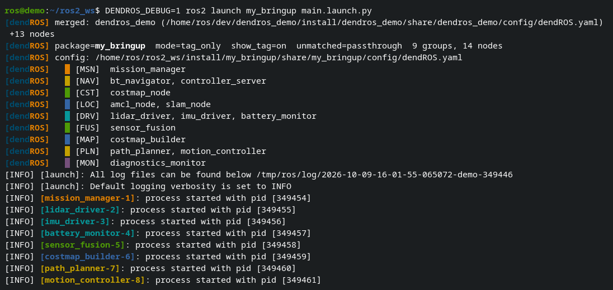

# Config Merging

When a launch file includes other packages, DendROS automatically merges their `dendROS.yaml` configs at runtime.

---

## How it works

```text
ros2 launch my_bringup main.launch.py
         │
         ├── my_bringup/config/dendROS.yaml    ← primary (wins conflicts)
         ├── nav2_bringup/config/dendROS.yaml  ← merged in
         └── slam_toolbox/config/dendROS.yaml  ← merged in
```

With `DENDROS_DEBUG=1` you can see the merge happen: `my_bringup` includes `dendros_demo`'s launch file, so its config is merged in and every group from both packages is listed.

<div class="term">
  <div class="term-bar">
    <div class="term-dots">
      <div class="term-dot term-dot-red"></div>
      <div class="term-dot term-dot-yellow"></div>
      <div class="term-dot term-dot-green"></div>
    </div>
    <div class="term-title">DENDROS_DEBUG=1 ros2 launch my_bringup main.launch.py</div>
  </div>
  <div class="term-body-image">
  <p align="center">

</p>
</div>
</div>

When `ros2 launch` is intercepted, DendROS:

1. Parses the launch file for package references.
2. Locates each referenced package's `dendROS.yaml` via `ros2 pkg prefix` or `AMENT_PREFIX_PATH`.
3. Merges all configs — the **primary package wins** any node-name conflicts.
4. Processes output with the merged config.

!!! info "Merge depth"
    Config merging is **one level deep only** — packages included by included packages are not recursively scanned (for the time being).

---

## Supported formats

=== "Python (.py)"

    ```python
    get_package_share_directory('nav2_bringup')
    FindPackageShare('slam_toolbox')
    ```

=== "XML (.xml / .launch)"

    ```xml
    <include file="$(find-pkg-share nav2_bringup)/launch/bringup.launch.py"/>
    ```

---

## Conflict resolution

When the same node name appears in multiple configs, the primary package's definition wins.
Among secondaries, the first one found in parse order wins.

---

## Toggling

Config merging is **on** by default. It is a global setting only; to disable it:

```bash
dendros config   # System tab → "Config merge" → off
```

or set `config_merge: false` in `~/.config/dendROS/defaults.yaml`.
