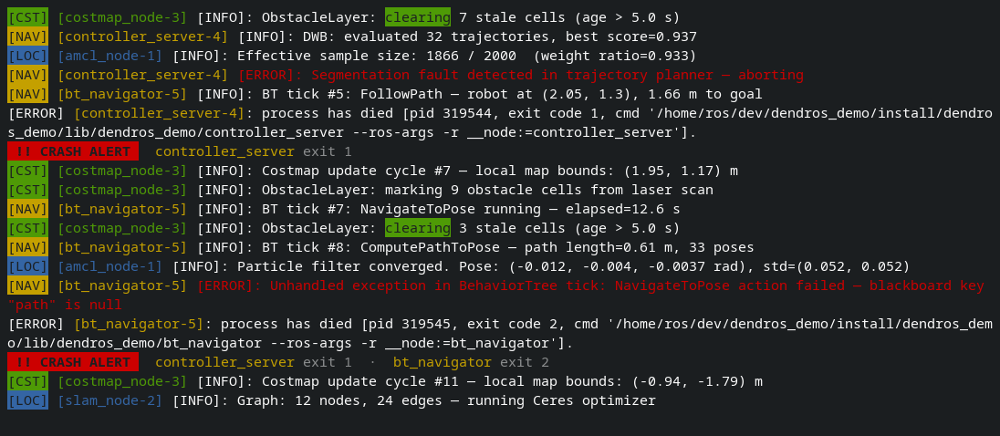

# Crash Alert

When a node dies unexpectedly, DendROS prints an inline banner immediately after the death line and repeats it periodically so you don't lose it in fast-scrolling output.

Enabled by default. Change it in the **Diagnostics** tab of `dendros config`, or directly in `~/.config/dendROS/defaults.yaml`:

```yaml
crash_alert: true
crash_alert_color: node   # node | red
crash_alert_interval: 30  # seconds; 0 = only on new crashes
```

---

## What it looks like

<div class="term">
  <div class="term-bar">
    <div class="term-dots">
      <div class="term-dot term-dot-red"></div>
      <div class="term-dot term-dot-yellow"></div>
      <div class="term-dot term-dot-green"></div>
    </div>
    <div class="term-title">Crash Alert</div>
  </div>
  <div class="term-body-image">
  <p align="center">

</p>
</div>
</div>

The banner appears directly in the terminal after the death line — no separate window, no scroll regions. The terminal is completely clean after `Ctrl-C`.

---


## Options

### `crash_alert_color`

Controls the color used for node names inside the banner.

| Value | Effect |
|---|---|
| `node` *(default)* | Each node name is shown in its configured group color |
| `red` | All node names are shown in bold red, regardless of group |

`node` is useful when you have many groups and want to immediately know which subsystem crashed. `red` gives a uniform alarm-style look.

### `crash_alert_interval`

Seconds between periodic banner reprints (default: `30`).

| Value | Effect |
|---|---|
| `30` *(default)* | Reprint every 30 s |
| `0` | Print once per new crash event; no periodic reprints |

### Configuring via `dendros config`

All three settings are in the **Diagnostics** tab:

| Setting | Values |
|---|---|
| **Crash alert** | `on` / `off` |
| **Alert color** | `node` / `red` |
| **Alert interval (s)** | integer (seconds) |

---

## Notes

- **Traceback suppression** — if a node printed a Python traceback before dying, the crash alert for that node is skipped. The traceback already communicates the failure clearly enough; a redundant banner adds noise.
- **Ctrl-C suppression** — once `Ctrl-C` is received, all subsequent node deaths are treated as expected cascade shutdowns and produce no banner. Only true mid-run crashes (before any `Ctrl-C`) trigger the alert.
- Exit codes are shown next to the node name when available (`exit 1`, `exit -11`).
- In [TUI mode](launch-tui.md) the banner is pinned in the header instead of being reprinted in the log.
- The `[node-N]` numeric suffix is stripped before the name is displayed in the banner.
- If a node has no configured group color (unmatched node), the banner falls back to bold red.
