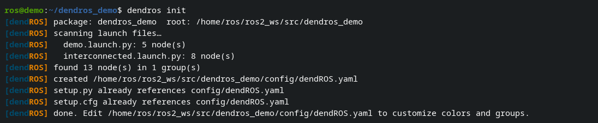
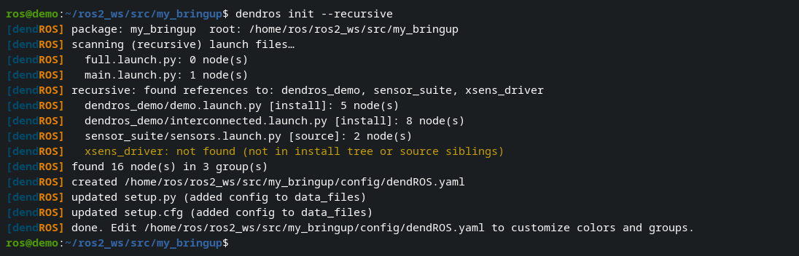

# dendros init

`dendros init` scaffolds a `config/dendROS.yaml` from a package's launch files automatically.

---

## Basic usage

```bash
cd ~/ros2_ws/src/my_bringup
dendros init
```

Run it from the **package root**, the directory that contains `package.xml`. From anywhere else it stops without writing anything; from a subfolder of a package it tells you which directory to run it from.

DendROS scans every `.py` and `.xml` file in `launch/`, extracts all `Node()` / `ComposableNode()` / `<node/>` declarations, groups them by source package, and writes `config/dendROS.yaml`. It also patches `CMakeLists.txt` / `setup.py` / `setup.cfg` to install the config. If no nodes are found, nothing is written and no build file is touched.

<div class="term">
  <div class="term-bar">
    <div class="term-dots">
      <div class="term-dot term-dot-red"></div>
      <div class="term-dot term-dot-yellow"></div>
      <div class="term-dot term-dot-green"></div>
    </div>
    <div class="term-title">dendros init</div>
  </div>
  <div class="term-body-image">
  <p align="center">

</p>
</div>
</div>

**Generated config:**

```yaml
groups:
  my_bringup:
    color: blue
    label: ""          # ← fill in manually (or use --labels)
    nodes:
      - my_node
      - another_node
      - third_node

defaults:
  color_mode: tag_only
  show_group_tag: true
  unmatched_color: null
```

---

## Recursive mode

```bash
dendros init --recursive   # or: dendros init -r
```

Follows `IncludeLaunchDescription` / `<include>` references into external packages (BFS, cycle-safe).

**Package lookup order:**

1. `ros2 pkg prefix <pkg>` → installed packages
2. Scan `AMENT_PREFIX_PATH` entries
3. Sibling directory in the same `src/` folder (packages in source but not yet built)

<div class="term">
  <div class="term-bar">
    <div class="term-dots">
      <div class="term-dot term-dot-red"></div>
      <div class="term-dot term-dot-yellow"></div>
      <div class="term-dot term-dot-green"></div>
    </div>
    <div class="term-title">dendros init --recursive</div>
  </div>
  <div class="term-body-image">
  <p align="center">

</p>
</div>
</div>

---

## Auto-generate labels

```bash
dendros init --labels   # or: dendros init -l
dendros init -r -l      # recursive + labels
```

| Package name | Generated label |
|---|---|
| `slam_toolbox` | `ST` |
| `nav2_bringup` | `NB` |
| `robot_state_publisher` | `RSP` |

Without `--labels`, every group gets `label: ""` as a placeholder.

---

## Behavior options

All options are in the **Init** tab of `dendros config`:

| Setting | Values | Description |
|---|---|---|
| `init_on_existing` | `abort` *(default)* / `merge` / `overwrite` | What to do if the config already exists. `merge` adds new nodes only. |
| `init_modify_build` | `on` *(default)* / `off` | Auto-patch `CMakeLists.txt` / `setup.py` / `setup.cfg`. |
| `init_color` | `palette` *(default)* / `null` | Assign cycling colors or leave as `color: null`. |
| `init_color_bold` | `off` *(default)* / `on` | Prefix every palette color with `bold`. |
| `init_label` | `off` *(default)* / `on` | Auto-generate labels (same as `--labels`). |

!!! tip "Iterative development"
    Set `init_on_existing: merge` to safely re-run `dendros init` as your launch files evolve — new nodes are appended without touching existing groups.
