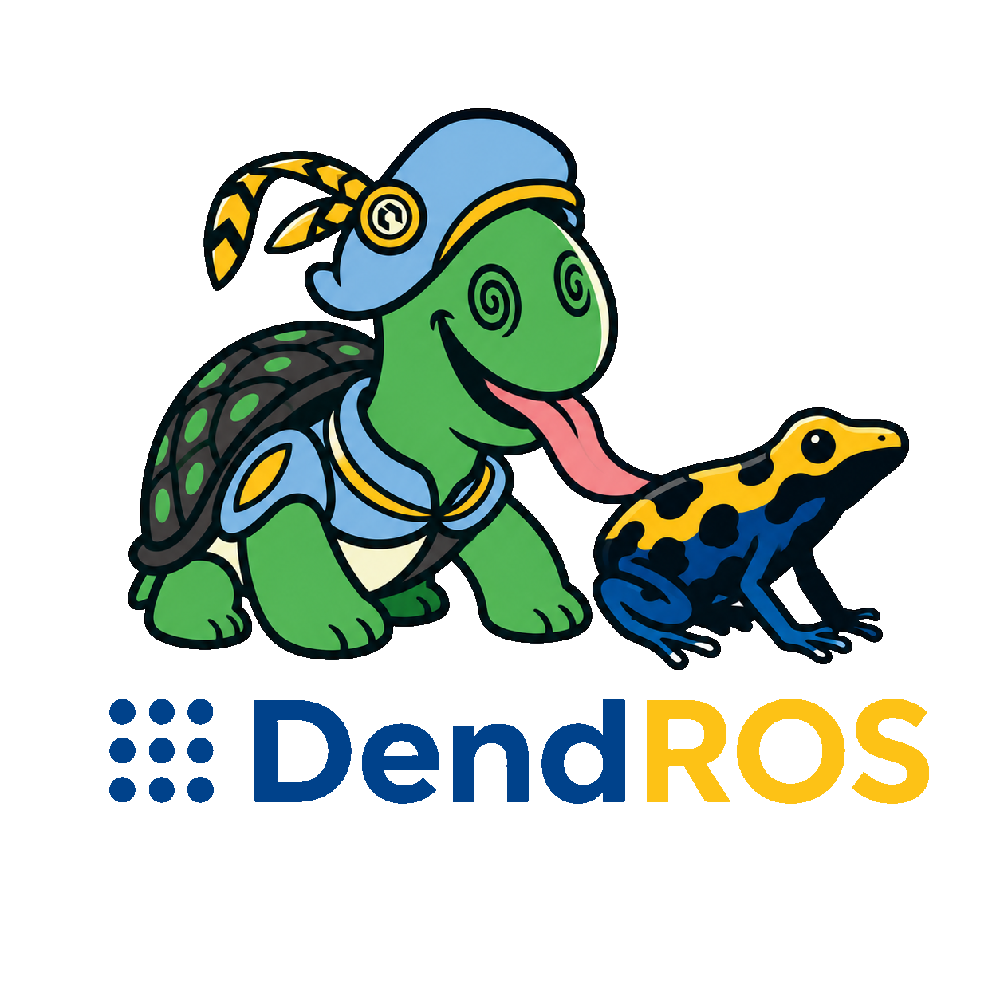
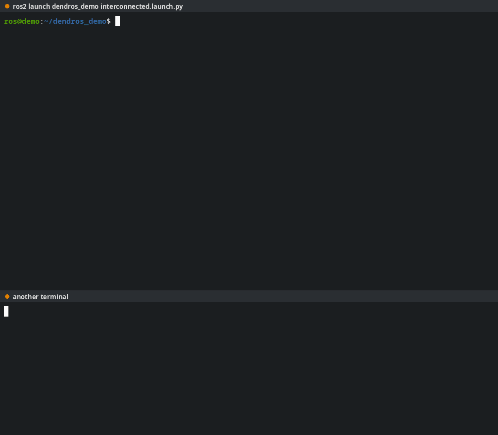

# DendROS

<p align="center">
  
</p>

<p align="center"><strong>Colorized ROS 2 terminal output.</strong></p>

---

<div class="term">
  <div class="term-bar">
    <div class="term-dots">
      <div class="term-dot term-dot-red"></div>
      <div class="term-dot term-dot-yellow"></div>
      <div class="term-dot term-dot-green"></div>
    </div>
    <div class="term-title">DendROS in action</div>
  </div>
  <div class="term-body-image">
  <p align="center">

</p>
</div>
</div>

DendROS wraps the `ros2` command and gives every group of nodes its own color, in `ros2 launch`, `ros2 run` and the `ros2` introspection commands. New in 1.1, `ros2 launch` opens in a **full-screen viewer**: scroll back, search, filter by node or severity, and copy with the mouse while the launch keeps running. Colors come from a small YAML file in your package. Packages without one are left untouched, and nothing changes in your launch files.

---

## Features

<div class="feature-grid" markdown>
<div class="feature-card" markdown>
<div class="fc-icon" markdown>:material-monitor-dashboard:</div>
<strong>Full-screen launch viewer</strong>
<p>TUI mode turns <code>ros2 launch</code> into a scrollable log with mouse copy, a pinned crash banner and a live scrollbar. [TUI Mode →](launch-tui.md)</p>
</div>
<div class="feature-card" markdown>
<div class="fc-icon" markdown>:material-filter-variant:</div>
<strong>Filter and search the live log</strong>
<p>Press <code>\</code> to <code>focus</code> on nodes, filter by <code>level</code> or <code>grep</code>, <code>find</code> text, <code>mute</code> noise, <code>mark</code> a moment and <code>tee</code> the view to a file. [Console →](tui-console.md)</p>
</div>
<div class="feature-card" markdown>
<div class="fc-icon" markdown>:material-remote:</div>
<strong>Remote control and reopen</strong>
<p>Drive a running launch from another terminal with <code>dendros focus</code>, and bring back the last run with <code>dendros reopen</code>. [More →](tui-remote.md)</p>
</div>
<div class="feature-card" markdown>
<div class="fc-icon" markdown>:material-palette-swatch:</div>
<strong>Group colors and badges</strong>
<p>One color and badge per group of nodes, with wildcards and keyword highlighting. <code>dendros init</code> writes the config for you. [Package Config →](configuration.md)</p>
</div>
<div class="feature-card" markdown>
<div class="fc-icon" markdown>:material-alert-decagram:</div>
<strong>Crashes, tracebacks, parameters</strong>
<p>A banner when a node dies, highlighted Python tracebacks, and an inline notice when a parameter changes. [Crash Alert →](crash-alert.md)</p>
</div>
<div class="feature-card" markdown>
<div class="fc-icon" markdown>:material-graph-outline:</div>
<strong>Colorized ros2 CLI</strong>
<p><code>ros2 node</code>, <code>topic</code>, <code>service</code>, <code>action</code> and <code>param</code> listings use the same group colors and badges. [See all →](ros2-cli.md)</p>
</div>
</div>

---

## Quick start

```bash
git clone https://github.com/mlisi1/DendROS
cd DendROS && bash install.sh && source ~/.bashrc
```

```bash
cd ~/ros2_ws/src/my_bringup
dendros init --recursive --labels
```

```bash
colcon build --packages-select my_bringup
source install/setup.bash
ros2 launch my_bringup main.launch.py
```

See [Installation](installation.md) for the full setup or [Quick Start](quickstart.md) for a step-by-step walkthrough.
