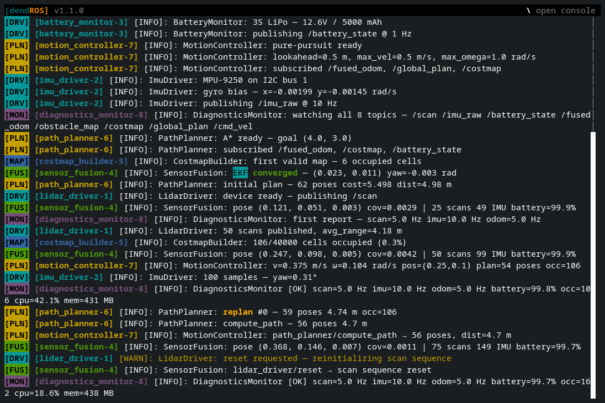
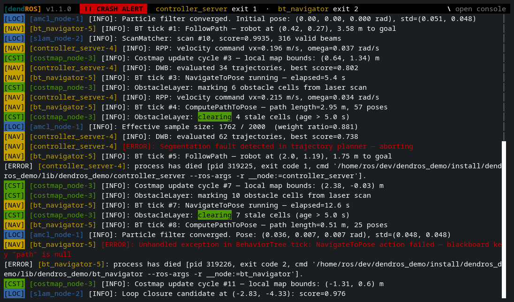
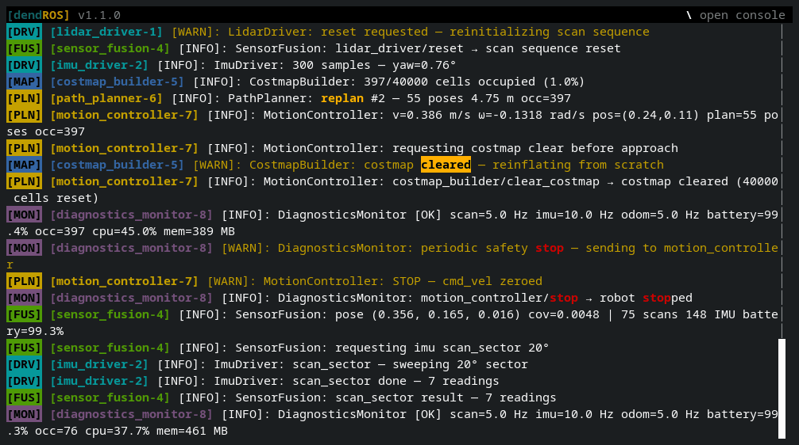
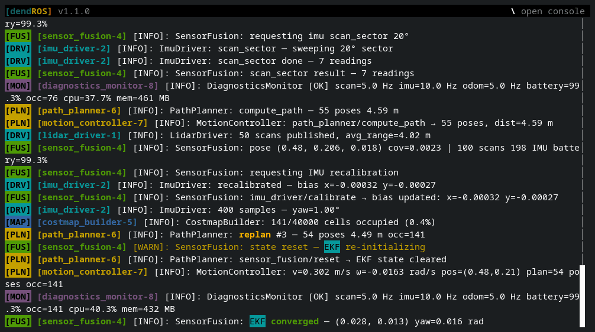
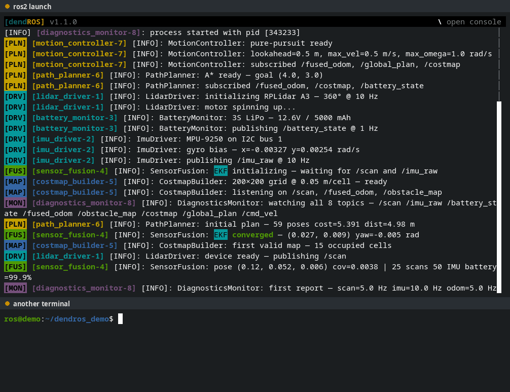

# TUI Mode

TUI mode turns `ros2 launch` into a full-screen log viewer. The output is the same as in classic mode, with the same colors, badges, crash alerts and highlights, but you can scroll back through it, search it, filter it and copy from it while the launch keeps running.

```yaml
# ~/.config/dendROS/defaults.yaml
launch_mode: tui            # classic | tui
tui_scrollback_lines: 5000  # how many lines the TUI keeps
```

Or switch **Launch mode** to `tui` in the **Output** tab of [`dendros config`](global-config.md).

---

## What it looks like

<div class="term">
  <div class="term-bar">
    <div class="term-dots">
      <div class="term-dot term-dot-red"></div>
      <div class="term-dot term-dot-yellow"></div>
      <div class="term-dot term-dot-green"></div>
    </div>
    <div class="term-title">TUI Mode</div>
  </div>
  <div class="term-body-image">
  <p align="center">

</p>
</div>
</div>

The screen has three parts:

- **Header** (top row): the DendROS title and version, the crash and parameter-change banners (pinned, so they can't scroll away), any active filters and searches, and a hint for the keys that are useful right now.
- **Log body**: the launch output, wrapped to the terminal width, with a scrollbar on the right.
- **Console bar** (bottom row, only while open): where you type [console commands](tui-console.md).

When a node dies, the crash banner stays pinned in the header, however far the log scrolls:

<div class="term">
  <div class="term-bar">
    <div class="term-dots">
      <div class="term-dot term-dot-red"></div>
      <div class="term-dot term-dot-yellow"></div>
      <div class="term-dot term-dot-green"></div>
    </div>
    <div class="term-title">Crash banner</div>
  </div>
  <div class="term-body-image">
  <p align="center">

</p>
</div>
</div>

---

## When TUI mode is used

TUI mode applies to `ros2 launch` only. `ros2 run` and every other subcommand always use classic output.

DendROS falls back to classic output automatically, before printing anything, when:

- stdout is not a terminal (for example `ros2 launch … | tee log.txt` or `> file`)
- curses can't start in the current terminal

So scripts, CI jobs and redirected output keep working exactly as before.

---

## Scrolling

| Key / action | Effect |
|---|---|
| Mouse wheel, ++up++ / ++down++ | Scroll a few lines |
| ++page-up++ / ++page-down++ | Scroll one page |
| ++home++ | Jump to the oldest line |
| ++end++ | Jump back to the live tail and follow new output |

<div class="term">
  <div class="term-bar">
    <div class="term-dots">
      <div class="term-dot term-dot-red"></div>
      <div class="term-dot term-dot-yellow"></div>
      <div class="term-dot term-dot-green"></div>
    </div>
    <div class="term-title">Scrolling</div>
  </div>
  <div class="term-body-image">
  <p align="center">

</p>
</div>
</div>

While you're scrolled up, new output keeps arriving below without moving your view. Scrolling back to the bottom (or pressing ++end++) resumes following the tail.

Long lines are wrapped at the terminal width. Resizing the terminal re-wraps everything, including the scrollback.

The TUI keeps the last `tui_scrollback_lines` lines (default 5000). Older lines are dropped.

---

## Selecting and copying

Click and drag with the mouse to select text. Releasing the button copies the selection to the clipboard, and a **Copied** toast flashes in the header. The selection stays in place while new output arrives and while you scroll.

<div class="term">
  <div class="term-bar">
    <div class="term-dots">
      <div class="term-dot term-dot-red"></div>
      <div class="term-dot term-dot-yellow"></div>
      <div class="term-dot term-dot-green"></div>
    </div>
    <div class="term-title">Selecting and copying</div>
  </div>
  <div class="term-body-image">
  <p align="center">

</p>
</div>
</div>

DendROS tries two ways to reach the clipboard at the same time:

- **OSC 52**, an escape sequence the terminal handles. Works over SSH and inside tmux when the terminal supports it.
- **`xclip`, `xsel` or `wl-copy`**, if one is installed. Reaches the local clipboard directly.

!!! warning "Some terminals ignore OSC 52"
    Several VTE-based terminals (Terminator, for example) don't support OSC 52. On those, install `xclip` (X11) or `wl-clipboard` (Wayland) so copying works. When neither OSC 52 nor a clipboard tool can be relied on, the header shows `-- copy needs xclip/xsel/wl-copy (none found) --`.

---

## Stopping the launch

++ctrl+c++ stops the launch as usual. Nodes that die during shutdown don't trigger crash alerts.

The TUI stays open after the launch exits, so you can keep reading, searching and copying. The header shows `-- process finished --`; press ++q++ to quit. Pressing ++ctrl+c++ a second time closes the viewer right away.

Closed it too early? [`dendros reopen`](tui-remote.md#reopen-the-last-run) brings the last run back.

---

## Disabling mid-run

[`dendros disable`](runtime-control.md) from any terminal closes the TUI within about a second and switches the launch to plain passthrough output. `dendros enable` reopens the TUI with the full scrollback, including whatever was printed while it was disabled.

<div class="term">
  <div class="term-bar">
    <div class="term-dots">
      <div class="term-dot term-dot-red"></div>
      <div class="term-dot term-dot-yellow"></div>
      <div class="term-dot term-dot-green"></div>
    </div>
    <div class="term-title">dendros disable / enable</div>
  </div>
  <div class="term-body-image">
  <p align="center">

</p>
</div>
</div>

---

## Configuring via `dendros config`

Both settings are in the **Output** tab:

| Setting | Values | Description |
|---|---|---|
| **Launch mode** | `classic` / `tui` | `tui` opens `ros2 launch` in the full-screen viewer. |
| **TUI scrollback lines** | integer | How many lines the TUI keeps. Default `5000`. |

---

## Notes

- TUI mode is a global setting only. There's no per-package or per-invocation override.
- Colors are approximated to the nearest of the terminal's 256 colors, so hex and extended colors can look slightly different than in classic mode.
- Lines are wrapped by character, not by word, like `less`.
- Exit codes are preserved, as in classic mode.
- Everything that works in classic mode ([crash alert](crash-alert.md), [traceback highlighting](traceback-highlighting.md), [parameter change alert](param-change-alert.md), [keyword highlighting](configuration.md#keyword-highlighting)) works the same in the TUI.
