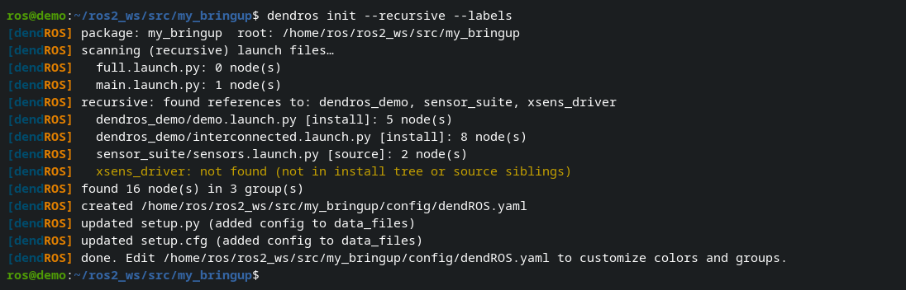
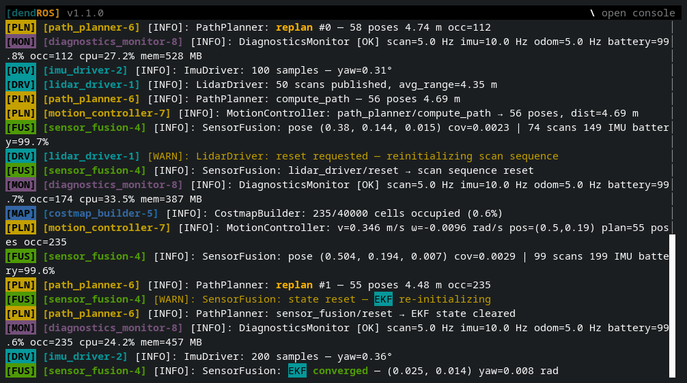
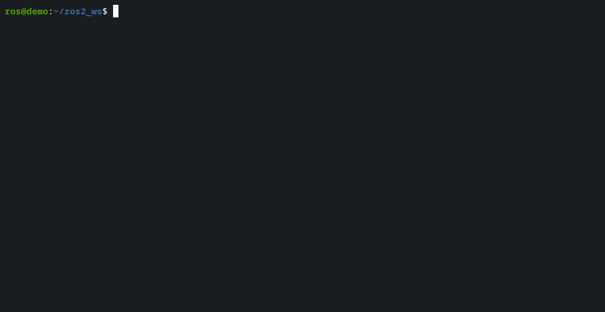

# Quick Start

A complete walkthrough from zero to colorized output.

---

## Step 1 — Install

```bash
git clone https://github.com/mlisi1/DendROS
cd DendROS && bash install.sh && source ~/.bashrc
```

---

## Step 2 — Scaffold a config

Run `dendros init` from inside your bringup package:

```bash
cd ~/ros2_ws/src/my_bringup
dendros init
```

!!! tip "Recursive mode"
    If your launch file includes other packages, use `--recursive` to follow them:
    ```bash
    dendros init --recursive          # follow IncludeLaunchDescription / <include>
    dendros init --recursive --labels # also auto-generate short badge labels
    ```

<div class="term">
  <div class="term-bar">
    <div class="term-dots">
      <div class="term-dot term-dot-red"></div>
      <div class="term-dot term-dot-yellow"></div>
      <div class="term-dot term-dot-green"></div>
    </div>
    <div class="term-title">dendros init --recursive --labels</div>
  </div>
  <div class="term-body-image">
  <p align="center">

</p>
</div>
</div>

---

## Step 3 — Edit the config

Open the generated `config/dendROS.yaml` and set colors and labels:

```yaml
groups:
  nav2_bringup:
    color: "bold green"
    label: "NAV"
    nodes:
      - bt_navigator
      - controller_server
      - planner_server

  slam_toolbox:
    color: "bold blue"
    label: "LOC"
    nodes:
      - slam_toolbox

defaults:
  color_mode: tag_only
  show_group_tag: true
  unmatched_color: null
```

See [Configuration](configuration.md) for the full format and [Colors](colors.md) for all accepted values.

---

## Step 4 — Build and launch

```bash
cd ~/ros2_ws
colcon build --packages-select my_bringup
source install/setup.bash
ros2 launch my_bringup main.launch.py
```

!!! success "Done"
    `ros2 launch` now opens in the DendROS viewer, with your groups colored. No other changes to your launch files or ROS 2 setup are needed.

<div class="term">
  <div class="term-bar">
    <div class="term-dots">
      <div class="term-dot term-dot-red"></div>
      <div class="term-dot term-dot-yellow"></div>
      <div class="term-dot term-dot-green"></div>
    </div>
    <div class="term-title">ros2 launch my_bringup main.launch.py</div>
  </div>
  <div class="term-body-image">
  <p align="center">

</p>
</div>
</div>

Scroll with the mouse wheel or ++page-up++ / ++page-down++, drag to copy, ++ctrl+c++ to stop the launch and ++q++ to close the viewer. See [TUI Mode](launch-tui.md).

---

## Step 5 — Filter and search

Press ++backslash++ in the viewer and type a command:

```text
\focus slam_toolbox
\level warn
```

<div class="term">
  <div class="term-bar">
    <div class="term-dots">
      <div class="term-dot term-dot-red"></div>
      <div class="term-dot term-dot-yellow"></div>
      <div class="term-dot term-dot-green"></div>
    </div>
    <div class="term-title">focus + level + grep</div>
  </div>
  <div class="term-body-image">
  <p align="center">

</p>
</div>
</div>

See [Console Commands](tui-console.md) for all of them.

??? note "Prefer the classic scrolling output?"
    Set **Launch mode** to `classic` in the **Output** tab of `dendros config`, or `launch_mode: classic` in `~/.config/dendROS/defaults.yaml`. `ros2 launch` then prints colorized output straight to the terminal, as `ros2 run` always does:

    <div class="term">
      <div class="term-bar">
        <div class="term-dots">
          <div class="term-dot term-dot-red"></div>
          <div class="term-dot term-dot-yellow"></div>
          <div class="term-dot term-dot-green"></div>
        </div>
        <div class="term-title">launch_mode: classic</div>
      </div>
      <div class="term-body-image">
      <p align="center">
    
    </p>
    </div>
    </div>

---

## Turning it off

`dendros disable` turns DendROS off in every terminal, including launches that are already running; `dendros enable` turns it back on. To skip it for a single command, prefix it with `DENDROS_DISABLE=1`. See [Enable & Disable](runtime-control.md).

---

## Next steps

- [Package Config](configuration.md): groups, badges, keyword highlighting
- [Colors](colors.md): every accepted color format
- [Global Settings](global-config.md): defaults for all packages
- [Troubleshooting](troubleshooting.md): no colors, wrong colors, terminal quirks
