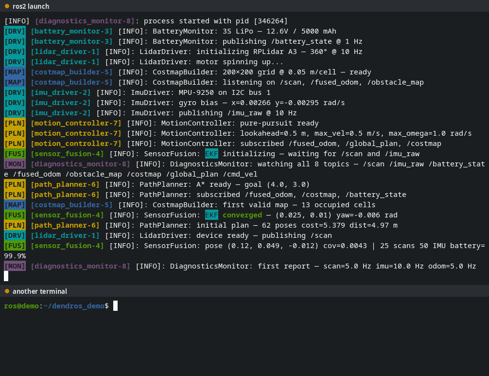
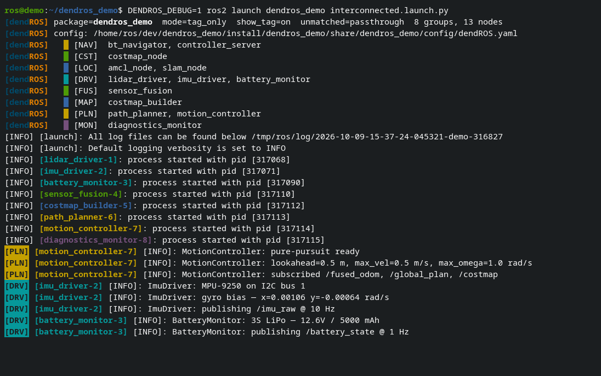

# Enable & Disable

DendROS can be switched off and on at any time, including while a launch is running, without rebuilding or restarting anything.

```bash
dendros disable   # plain ros2 output everywhere
dendros enable    # colorized output again
```

---

## System-wide: `dendros disable` / `dendros enable`

`dendros disable` turns DendROS off for **every terminal**:

- New `ros2` commands in any terminal run without DendROS.
- `ros2 launch` and `ros2 run` commands that are **already running**, in any terminal, switch to plain output within about a second. The launch itself is not restarted.
- A [TUI](launch-tui.md) launch closes its full-screen view and continues as plain output.

`dendros enable` reverses it. Running launches pick it up within about a second, and a TUI launch reopens with its full scrollback, including the lines printed while DendROS was disabled.

=== "Classic mode"

    The running launch drops to plain `ros2` output, then colorizes again.

    <div class="term">
      <div class="term-bar">
        <div class="term-dots">
          <div class="term-dot term-dot-red"></div>
          <div class="term-dot term-dot-yellow"></div>
          <div class="term-dot term-dot-green"></div>
        </div>
        <div class="term-title">dendros disable / enable</div>
      </div>
      <div class="term-body-image">
      <p align="center">
    
    </p>
    </div>
    </div>

=== "TUI mode"

    The full-screen viewer closes and the launch continues as plain output. On `enable` it reopens with the whole scrollback.

    <div class="term">
      <div class="term-bar">
        <div class="term-dots">
          <div class="term-dot term-dot-red"></div>
          <div class="term-dot term-dot-yellow"></div>
          <div class="term-dot term-dot-green"></div>
        </div>
        <div class="term-title">dendros disable / enable</div>
      </div>
      <div class="term-body-image">
      <p align="center">
    
    </p>
    </div>
    </div>

The setting persists until you run `dendros enable`, including across reboots.

---

## One shell or one command: `DENDROS_DISABLE`

To bypass DendROS only in the current shell, or for a single command, use the environment variable instead:

```bash
DENDROS_DISABLE=1 ros2 launch my_bringup main.launch.py   # this command only
export DENDROS_DISABLE=1                                  # this shell
```

With `DENDROS_DISABLE=1` the real `ros2` binary is called directly, without any DendROS processing.

!!! note
    `dendros disable` also sets `DENDROS_DISABLE=1` in the shell where you ran it, and `dendros enable` unsets it there.

---

## Debug output: `DENDROS_DEBUG`

```bash
DENDROS_DEBUG=1 ros2 launch my_bringup main.launch.py
```

<div class="term">
  <div class="term-bar">
    <div class="term-dots">
      <div class="term-dot term-dot-red"></div>
      <div class="term-dot term-dot-yellow"></div>
      <div class="term-dot term-dot-green"></div>
    </div>
    <div class="term-title">DENDROS_DEBUG=1 ros2 launch dendros_demo interconnected.launch.py</div>
  </div>
  <div class="term-body-image">
  <p align="center">

</p>
</div>
</div>

Prints which config files were found, the groups they define and the resulting node-to-color map to stderr at startup. Useful when colors don't show up, see [Troubleshooting](troubleshooting.md). Set **Debug mode** in [`dendros config`](global-config.md#system) to turn it on permanently.

---

## Notes

- Packages without a `dendROS.yaml` are never modified, whether DendROS is enabled or not.
- Exit codes are preserved in every mode.
